
# Funnel logging design: spec and sequence diagrams

2026-11-05 · Draft · Local only.

**Related:**
- `docs/20261102-reliability-funnel-prd.md` (§5 event contract, §6 outcomes);
- `docs/20261105-recording-journey-event-index.md` (today's events, gaps G1–G19, tasks T1–T39);
- `docs/20261105-funnel-questions.md` (what the funnel must answer).

**Decisions behind this design (11/5):**

| Topic | Decision |
|---|---|
| Event store | `scribe_events`. No new table. |
| Funnel fields | In the payload JSON. No new columns. |
| Path to Mixpanel | scribe_events → the existing Pub/Sub topic → a new subscriber → Mixpanel |
| Sent to Mixpanel | Funnel events only (§3) |
| Funnel unit | The recording: `recording_id` as a Mixpanel group key; distinct_id = account |
| Outcomes | A daily job in StarRocks classifies each recording and sends one `RECORDING_OUTCOME` event |
| Duplicates | `client_event_id` → Mixpanel `$insert_id`; the phone's `timestamp` is the event time |
| Grafana | Everything except the funnel chart: recording list, timeline, ops dashboards, alerts |
| Warehouse | StarRocks (scribe_events already lands there via the same topic) |
| App's own Mixpanel events | Not part of the funnel; they stay for product analytics |
| Scope | All paths at once: mobile chunking, mobile single-file, web app, Chrome extension |
| Compliance | **Mixpanel approval to confirm** before anything is sent. Only ids, codes, platform and version are sent. |

---

## 1. Architecture

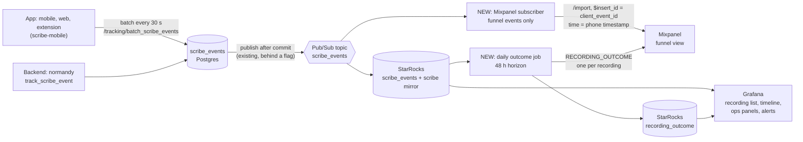

**What exists today:**
- **App batching:** events are written to local SQLite and uploaded every 30 s (`lib/services/tracking/batching_event_tracker_service.dart`).
- **Backend writes:** both write paths, single (`track_scribe_event`, `normandy/app/utils/tracking.py:101`) and batch (`track_scribe_events_bulk`, `:175`), publish every event after the commit (`publish_scribe_event`, `normandy/app/utils/scribe_event_publisher.py:71`), gated by `is_publish_scribe_event_enabled`. The topic already feeds StarRocks.

**What's new:**
- **The subscriber:** filters to the funnel events (§3), maps each to a Mixpanel event (§5) and sends it with the `/import` API. `/import` accepts old timestamps, which matters because phones can hold events for days.
- **Delivery is best-effort:** a failed send goes to a retry queue and never blocks the Postgres write.
- **The outcome job:** daily, over recordings attempted in the last 3 days, plus any recording with a late event.
  - It writes `recording_outcome` in StarRocks.
  - It sends one `RECORDING_OUTCOME` per recording, and again only if the outcome changes.
- **Grafana:** reads StarRocks over the MySQL protocol.

**Backend change needed:**
- **`client_event_id`:** the app sends it on every event (`event_tracker_service.dart:234-284`), but `ScribeEventTracking` (`normandy/app/api/v1/scribe/models.py:1319`) has no column for it and drops it. Keep it inside `payload` (no schema change), so the subscriber can dedupe repeat sends, e.g. `APP_KILLED_DETECTED` sent twice.

---

## 2. Event contract

### 2.1 Common payload fields (every funnel event)

| Field | Value | Set by |
|---|---|---|
| `recording_id` | Same value as the `uuid` column. Created at `ATTEMPTED`. | app; backend uses `scribe.uuid` |
| `app_session_id` | One per app launch / page load | app |
| `install_id` | One per install / browser profile, kept on the device | app |
| `recording_seq` | Counter per recording, saved with the open-recording entry so it survives restarts | app |
| `client_event_id` | Random per event, kept across retries | app (exists); backend must keep it in payload |
| `contract_version` | `1` | app |
| `path` | `chunking` / `single_file` | app |
| `on_resume` | true when the event belongs to a resume | app |

**Already on every row:** `device_type`, `browser_name`, `version`, `scribe_account_id`, `scribe_id`, `timestamp` (phone time), `created_at` (server time).

**No patient data** in any field. Today `patient_name` is sent in four payloads and has to be removed first (T21).

### 2.2 Funnel events (forwarded to Mixpanel)

**Change:**
- 🆕 new event;
- ➕ field added to an existing event;
- 🔁 existing event, sent from more paths;
- ✅ unchanged.

| # | Stage | Tag / action | Key payload | Change |
|---|---|---|---|---|
| F1 | C0 | `RECORDING_LIFECYCLE / ATTEMPTED` | entry_point, recording_mode | 🆕 |
| F2 | C0 | `RECORDING_LIFECYCLE / PREFLIGHT_BLOCKED` | reason | 🆕 |
| F3 | C1 | `RECORDING_LIFECYCLE / MIC_LIVE` | ms_since_attempted, input_device | 🆕 |
| F4 | C1 | `RECORDING_LIFECYCLE / START_FAILED` | error_code, error_domain | 🆕 |
| F5 | C2 | `SCRIBE_AUDIO_CACHE_SYNC_V2 / CHUNK_ADDED` (**first per recording only**) | chunk_index, bytes | ➕ |
| F5b | C2 | `RECORDING_LIFECYCLE / AUDIO_PERSISTED` (single-file / web single-file) | storage, bytes | 🆕 |
| F6 | C2 | `SCRIBE_JOURNEY / PARALLEL_RECORDING_PAUSED` | reason | ➕ |
| F7 | C2 | `RECORDING_LIFECYCLE / INTERRUPTED` | source | 🆕 |
| F8 | C2 | `RECORDING_LIFECYCLE / RECORDING_FAILED` | stage, error_code | 🆕 |
| F9 | C2 / K | `RECORDING_LIFECYCLE / TERMINATED_UNEXPECTEDLY` | last_phase, last_seen_at, restored_as | 🆕 |
| F10 | C3 | `SCRIBE_JOURNEY / PARALLEL_RECORDING_ENDED` | reason, recording_length | ➕ 🔁 |
| F11 | C3 | `RECORDING_LIFECYCLE / DISCARDED` | reason | 🆕 |
| F12 | C4a | `SCRIBE_CHUNKING / FINALIZE_SUCCESS`, `FINALIZE_PARTIAL`, `FINALIZE_FAILED`, `FINALIZE_TIMEOUT` | stage, error_class, chunks_failed | ✅ |
| F12b | C4a | `RECORDING_LIFECYCLE / UPLOAD_FAILED` (single-file) | http_status, error_code, attempt_n | 🆕 |
| F13 | C4a | `SCRIBE_AUDIO_CACHE_SYNC_V2 / AUDIO_CACHE_ERROR` | reason | 🔁 |
| F14 | C4b | `SCRIBE_CHUNKING / SCRIBE_CREATED` | scribe_id, path | 🔁 |
| F15 | C4b | `RECORDING_LIFECYCLE / ABANDONED` | reason | 🆕 |
| F16 | B1 | `SCRIBE_JOURNEY / NORMANDY_WORKFLOWS_SCRIBE_JOURNEY_START` | — | ✅ (backend) |
| F17 | B2 | `SCRIBE_JOURNEY / NORMANDY_WORKFLOWS_TRANSCRIPTIONS_AND_OCRS_COMPLETED` | — | ✅ (backend) |
| F18 | B3 | `SCRIBE_JOURNEY / NORMANDY_WORKFLOWS_ALL_TASKS_COMPLETED` (first only) | — | ✅ (backend) |
| F19 | B1–B4 | `SCRIBE_LIFECYCLE / STATUS_CHANGED` | from, to, reason_code | 🆕 (backend) |
| F20 | — | `RECORDING_LIFECYCLE / RECORDING_OUTCOME` | outcome (1–18), outcome_evidence, flags | 🆕 (outcome job) |

**Not forwarded (they stay in scribe_events for Grafana):**
- 30-second resource pings;
- every chunk after the first;
- upload retries;
- cache health;
- diagnostics.

These feed the timeline, not the funnel.

**Subscriber filter:** the exact `(tag, action)` pairs above. For F5 and F18, forward only the first occurrence per `recording_id`. The subscriber keeps a small "seen" set keyed by `recording_id`, or the Mixpanel funnel's "first time" setting does it.

---

## 3. Per-path spec

Code paths are in `scribe-mobile/lib/src/features/` unless noted. Line numbers are at `c87c9fe7a`.

### 3.1 Shared start (all paths)

| Event | Where | Notes |
|---|---|---|
| ATTEMPTED + recording id created | top of `visits/providers/start_visit_controller.dart` `startVisit()` (:58), after the double-tap lock | Written to `recordingUuidProvider`. Format: v4 for chunking, `scribe_audio_workflows_<hex>` for single-file. Open-recording entry saved (`phase: preflight`). |
| PREFLIGHT_BLOCKED | one switch at the end of `startVisit()` | 8 reasons (PRD §5.2.1). The Safari-iOS check moves in from `visit_info_screen.dart:2540`. |
| `RESOURCE_MONITORING / RECORDING_INITIATED` | `start_visit_controller.dart:75` | Changed to a single sample with the recording id (not forwarded) |

### 3.2 Mobile chunking (iOS, Android)

| Stage | Event | Where |
|---|---|---|
| C1 | MIC_LIVE | first packet in the stream listener, `record/providers/chunking_recording_state_notifier.dart:878` |
| C1 | START_FAILED | `:798-813`, `:493-543`, `start()` catch `:1013`, new 5 s watchdog |
| C2 | first CHUNK_ADDED (+ chunk_index, bytes) | `record/data/cache_repository.dart:1397` |
| C2 | PAUSED reason | `pauseParallelRecording()` callers (PRD §5.2.3) |
| C2 | INTERRUPTED | Android call `record/providers/recording_state_notifier.dart:855`; iOS interruption begin `:955`; device change `record/providers/device_change_mixin.dart:107` |
| K | TERMINATED_UNEXPECTEDLY | next launch, replacing the check in `main/providers/app_lifecycle_provider.dart:328`; started → `auto_paused` in `cache_repository.dart:1975` |
| C3 | ENDED reason | `chunking_recording_state_notifier.dart:1762`; too-short path `recording_state_notifier.dart:1403-1459` |
| C4a | FINALIZE_* | `record/services/chunking_analytics.dart` (exists) |
| C4a | AUDIO_CACHE_ERROR reason | `record/providers/chunk_upload_provider.dart` `_updateCacheState` (:465) |
| C4b | SCRIBE_CREATED | `chunk_upload_provider.dart:1875` (exists); add to `record/services/background_upload_retry_service.dart` (success) and the orphan recovery flow |

### 3.3 Mobile single-file

| Stage | Event | Where / difference |
|---|---|---|
| C1 | MIC_LIVE | first amplitude sample (`record/providers/native_recording_state_notifier.dart`, `amplitudeSubscription`) |
| C2 | AUDIO_PERSISTED | first time the file has data; `FILE_ADDED` doesn't count (it fires in initialize, `:397`) |
| C3 | ENDED | `recording_state_notifier.dart:1563` |
| C4a | UPLOAD_ATTEMPT / UPLOAD_FAILED | `record/providers/cache_upload_provider.dart` `upload` (:175); today only `SCRIBE_UPLOAD_ERROR` |
| C4b | SCRIBE_CREATED | **new on this path**: after the trigger succeeds (`cache_upload_provider.dart`, before `AUDIO_CACHE_UPLOAD_ENDED` :622) |

### 3.4 Web app (WEB_APP) and Chrome extension (WEB_CHROME)

The same Flutter code as mobile, built for web, so the chunking and single-file rules above apply. Differences:

| Topic | Web behaviour |
|---|---|
| Kills | No OS kill; a page refresh or tab close is the "kill". Open-recording entry in **localStorage** written at ATTEMPTED (today only on unload while recording, `app_lifecycle_provider.dart:179-202`). TERMINATED_UNEXPECTEDLY on next page load with `last_phase`. |
| Pre-checks | Duplicate-tab check active; storage warning skipped |
| Interruptions | No OS interruption events. Device change via `MIC_CHANGE_*`. |
| Tab state | `WEB_LIFECYCLE / TAB_FROZEN`, `TAB_UNFROZEN` (timeline only) |
| Single-file web | Audio is in memory until stop, so a refresh loses it. AUDIO_PERSISTED only at stop. |
| Extension | `SCRIBE_JOURNEY / EXTENSION_MINIMIZED_DURING_RECORDING` (timeline only) |
| Unload events | Send with `navigator.sendBeacon` (T22) |

### 3.5 Backend (normandy)

| Stage | Event | Where |
|---|---|---|
| B1 | `NORMANDY_WORKFLOWS_SCRIBE_JOURNEY_START` (exists) | `scribe/workflows/controllers.py:806` |
| B2 | `NORMANDY_WORKFLOWS_TRANSCRIPTIONS_AND_OCRS_COMPLETED` (exists) | `workflows/services.py:287` |
| B3 | `NORMANDY_WORKFLOWS_ALL_TASKS_COMPLETED` (exists; first only) | `scribe/workflows/services.py:4583` |
| B1–B4 | `SCRIBE_LIFECYCLE / STATUS_CHANGED` (new) | every `task_status` write (`update_scribe_status` :4360, `scribe_ehr_services.py:142`, `scribe/services.py:10393`, …) |
| — | `client_event_id` kept in payload (new) | `app/utils/tracking.py` `track_scribe_events_bulk` (:175) |

---

## 4. Sequence diagrams

Shorthand:
- **App** = scribe-mobile.
- **SE** = scribe_events (Postgres → Pub/Sub → StarRocks).
- **MP** = Mixpanel, via the subscriber.

Only funnel events (F#) go to MP.

### 4.1 Normal recording (chunking)

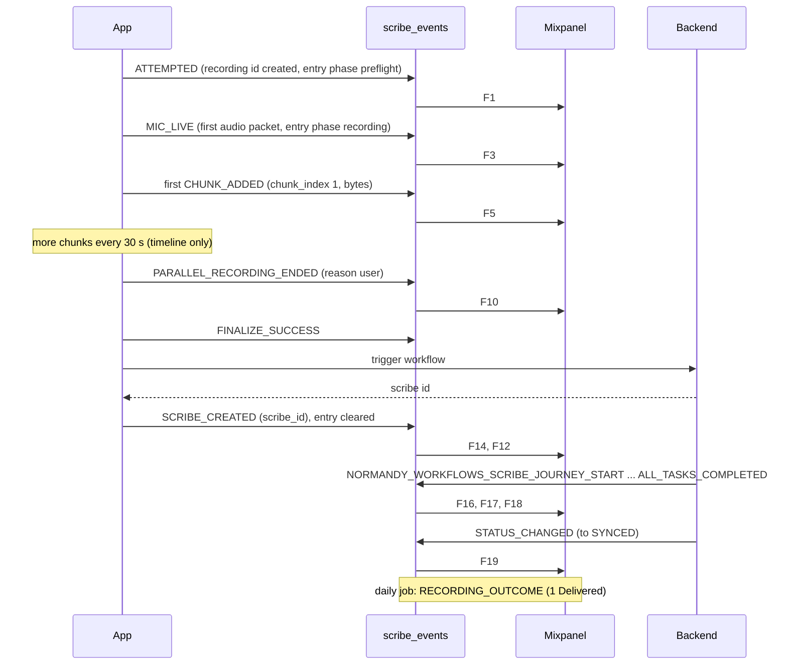

### 4.2 Blocked by a pre-check

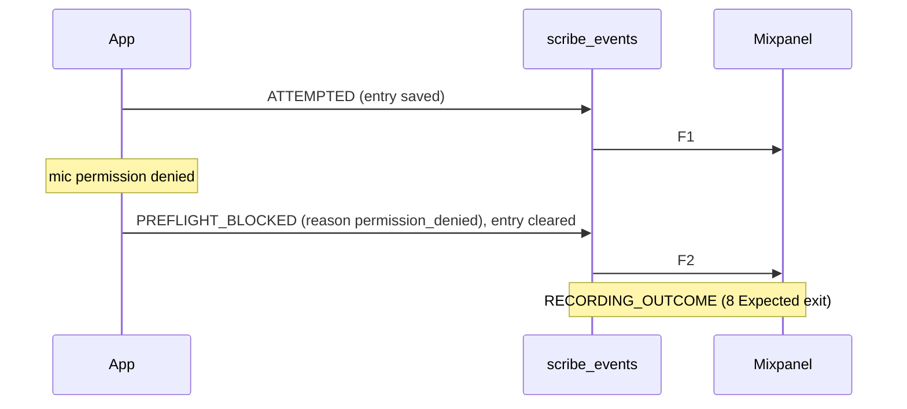

### 4.3 Start failed, then resume failed

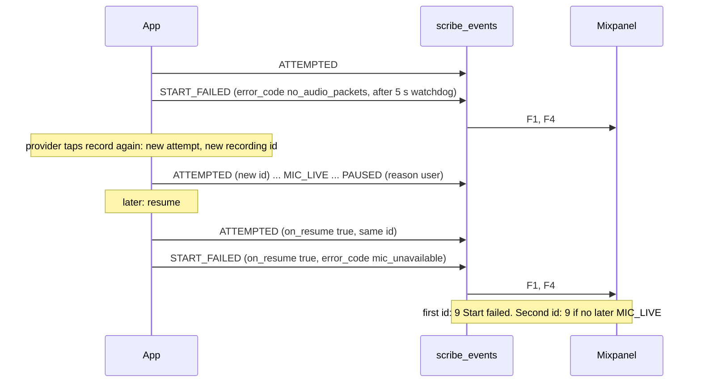

### 4.4 Paused by the user, then resumed

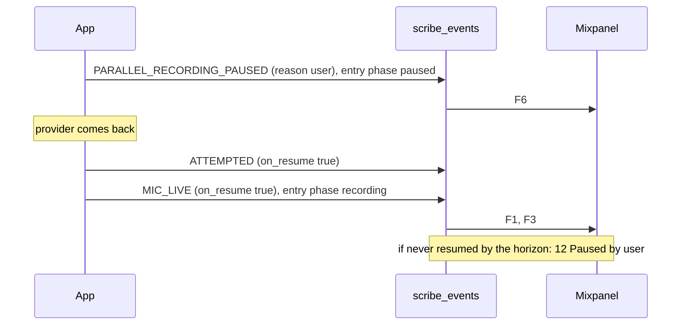

### 4.5 Phone call

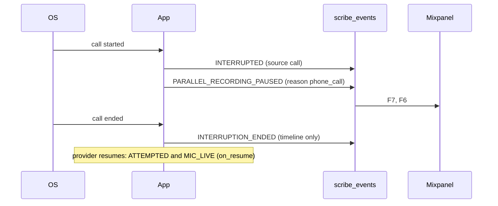

### 4.6 Killed mid-recording, recovered at the next launch

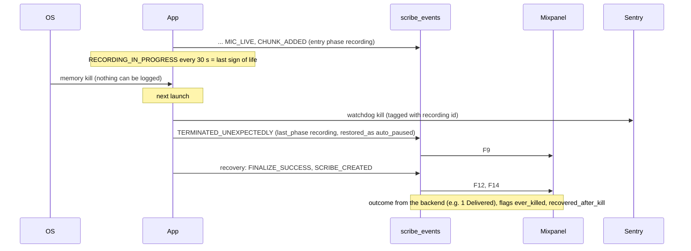

### 4.7 Killed before the mic started

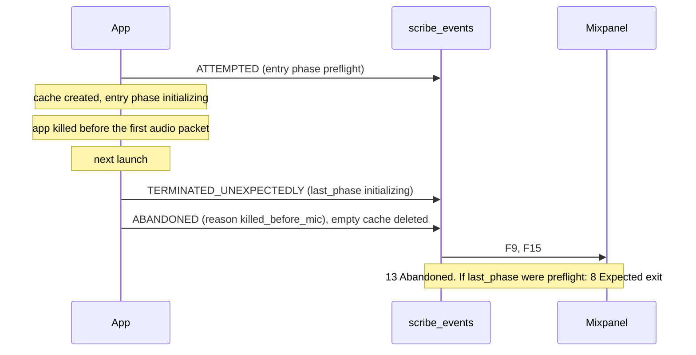

### 4.8 Upload stuck, background retry recovers

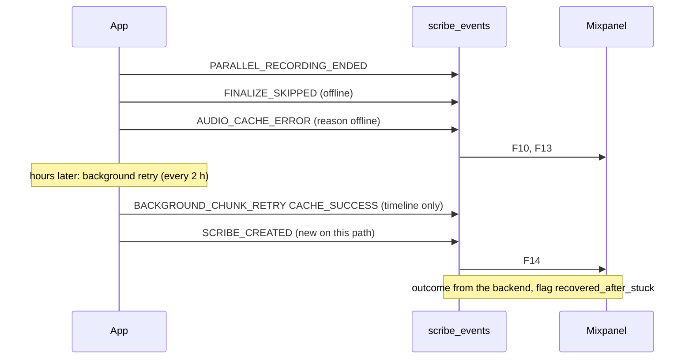

### 4.9 Lost

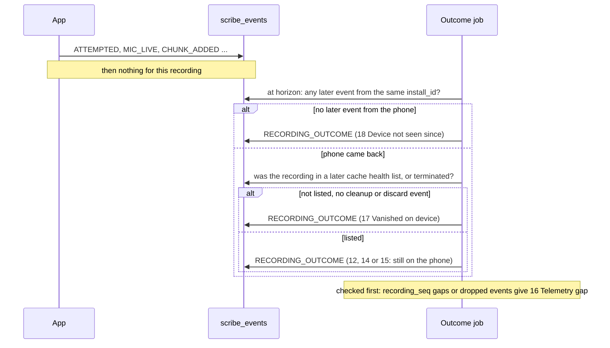

### 4.10 Single-file recording

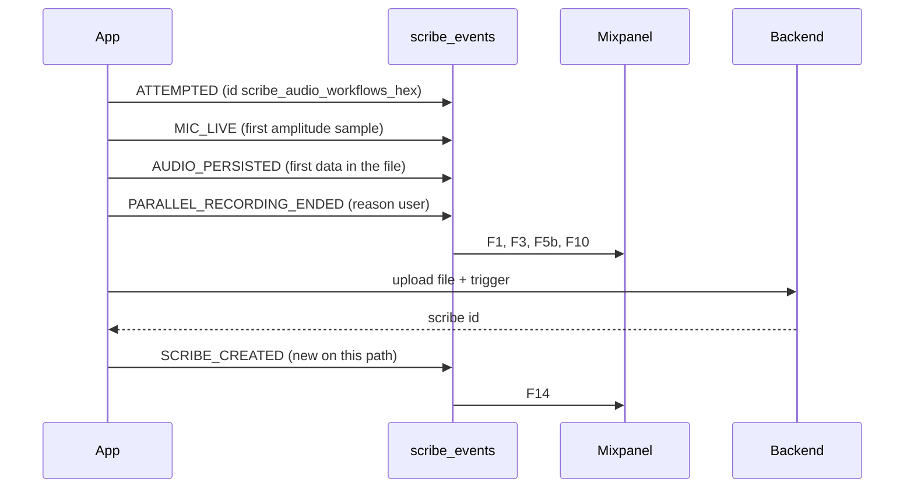

---

## 5. Mixpanel setup

- **Events:** one Mixpanel event per funnel event. Name = action, e.g. `ATTEMPTED`, `MIC_LIVE`, `SCRIBE_CREATED`.
- **Properties on every event:** platform (device_type + browser), app_version, path, on_resume, plus the payload fields from §2.2. Never free text.
- **Identity:** distinct_id = `scribe_account_id`. Group key `recording_id` (Group Analytics), so funnels count **recordings**.
- **Time:** the phone's `timestamp`; `$insert_id = client_event_id`. Sent with `/import`, which accepts events older than 5 days.
- **Main funnel (by recording):**
  1. ATTEMPTED (excluding `on_resume`)
  2. MIC_LIVE
  3. first CHUNK_ADDED / AUDIO_PERSISTED
  4. PARALLEL_RECORDING_ENDED
  5. SCRIBE_CREATED
  6. NORMANDY_WORKFLOWS_ALL_TASKS_COMPLETED
  7. STATUS_CHANGED to SYNCED / COPIED / MDS
- **Conversion window:** 48 h, the same as the outcome horizon.
- **Breakdowns:** platform, app_version, path, PREFLIGHT_BLOCKED reason, START_FAILED error_code, PAUSED reason, TERMINATED last_phase.
- **Outcome report:** `RECORDING_OUTCOME` by outcome × week, the same numbers as Grafana and the weekly report.

---

## 6. Grafana (StarRocks)

| View | Source | Notes |
|---|---|---|
| Recording list | `recording_outcome` | Filter by week, platform, version, account, outcome, flag. Link to the timeline. |
| Recording timeline | `scribe_events` by `uuid` + time window, plus the `scribe` row and crash rows | Filter on `uuid` and `created_at` first. Never filter on payload: payload parsing is what timed out in Retool on 11/3. |
| Ops panels | `recording_outcome` daily | Reliability, start failures, kills per 1k, upload stuck, lost |
| Alerts | same | Slack, linking to the recording list for that day and outcome |
| Crash band | `crash_events` (T32) joined to `recording_outcome` | Recordings lost per crash issue |

---

## 7. New tasks (added to the task list)

| # | Task | Owner | Phase |
|---|---|---|---|
| T35 | Pub/Sub → Mixpanel subscriber: filter the funnel events, map, send with `/import` and `$insert_id`, retry queue | Backend (TBD) | P0 |
| T36 | Keep `client_event_id` (in payload) on every app event | Backend (TBD) | P0 |
| T37 | Mixpanel approval (BAA / security), project, Group Analytics on `recording_id` | Arthur | P0 |
| T38 | Daily outcome job in StarRocks → `recording_outcome` + `RECORDING_OUTCOME` events | Arthur | P1 |
| T39 | Grafana recording list, timeline, ops panels (replaces the Retool page) | Arthur | P0 |

## 8. Open items

1. **Mixpanel approval:** is Mixpanel covered for this data (BAA)? Nothing is sent until confirmed.
2. **Mixpanel plan:** is Group Analytics available? If not, use distinct_id = `recording_id` in a separate Mixpanel project.
3. **Volume:** about 365k attempts a week × ~8 forwarded events, roughly 3M events a week. Check against the Mixpanel plan.
4. **Pub/Sub flag:** is `is_publish_scribe_event_enabled` on in production for all platforms?
5. **Grafana on StarRocks:** confirm the data source and access (Tailscale for viewers).
6. **Payload queries:** keep Grafana queries filtered on tag / uuid / time first. If timeline queries are still slow, revisit promoting a few fields to columns.


